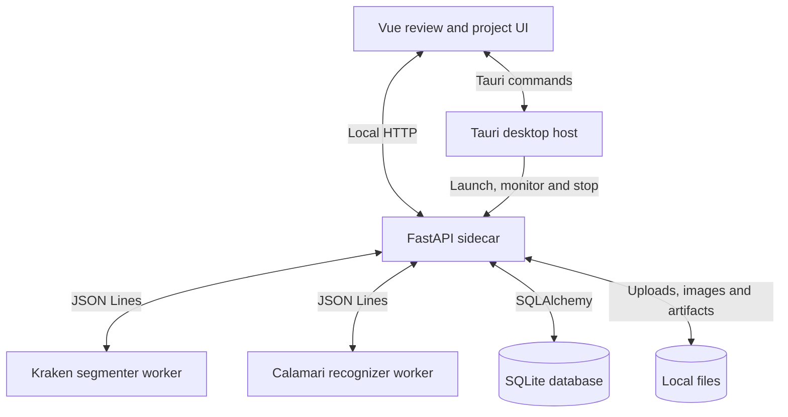

# System Overview

The application is split into three code areas that run as one desktop product:

- Vue frontend (`src/`) for UI workflows and local API calls.
- FastAPI backend (`backend/`) for persistence, OCR orchestration, and exports.
- Tauri host (`src-tauri/`) for desktop packaging and backend process lifecycle.

At runtime, the frontend talks to the local FastAPI sidecar launched by Tauri.
The API owns database access, job state, rasterization, and export generation.
It launches isolated Kraken segmentation and Calamari recognition workers and
exchanges JSON metadata and image paths with them.

In `src-tauri/src/backend/`, command and process modules expose backend status
and restart commands to the frontend while managing backend launch/shutdown.

## Runtime relationships

The frontend discovers the API URL through Tauri, then sends HTTP requests directly
to the API. Tauri manages the API process; the API launches and closes its workers.
The workers do not expose HTTP endpoints or own database sessions. They also access
page images and line crops on disk, as shown in the
[OCR exchange diagram](ocr-process-split.md#page-processing-and-persistence).

## Durable and temporary state

SQLite holds projects, pages, lines, and review corrections. Upload tokens and job
snapshots live in API memory; restarting the API does not preserve those records.
Uploaded PDFs, retained page/line images, and generated artifacts live in local
directories. Per-run temporary files are cleaned up by the job service.

See the [OCR walkthrough](../tutorials/first-ocr-run.md) to follow these relationships
through upload, recognition, review, and export.

See [isolated OCR runtimes](ocr-process-split.md) for development, packaging,
process lifetime and failure handling, and the worker contracts for IPC details.

See [backend code organization](backend-organization.md) for package ownership,
entry points, and the relationship between domain objects and database models.

See [frontend code organization](frontend-organization.md) for feature ownership,
shared services, and the separation between review geometry and overlay rendering.
