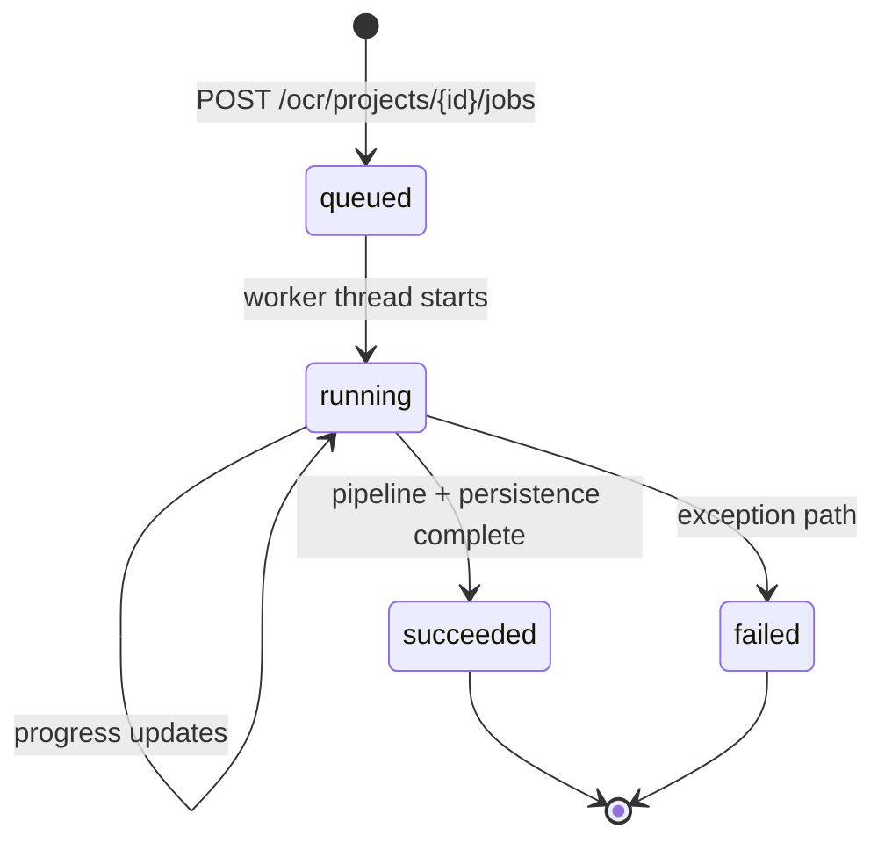
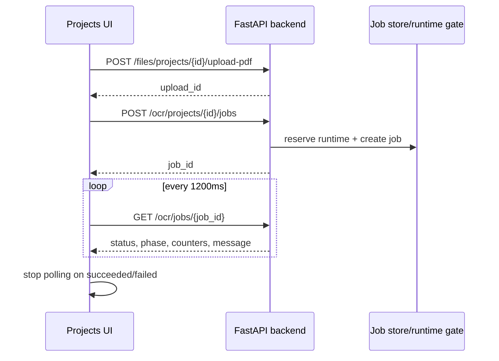

# Testing Architecture

This page is a manually maintained map; commands and platform details are in the
[testing guide](testing.md).

This document summarizes how tests are organized across backend, frontend, and
Tauri components, model-free orchestration checks, real ML inference, packaging,
and documentation validation.

Frontend tests follow feature ownership under `src/features/`, with app-shell
tests in `src/__tests__/` and shared-service tests in `src/shared/`. Review geometry
is tested as pure calculations, reactive composable state, and rendered SVG
interactions. See [frontend code organization](architecture/frontend-organization.md)
for ownership and the [generated test inventory](generated/test-inventory.md)
for exact paths. This architecture document is maintained manually; the inventory
is generated by `scripts/generate_docs.py`.

## Suite Topology

| Layer | Entry point | What it establishes |
| --- | --- | --- |
| API/component and fake-worker tests | `node scripts/run_backend.mjs -m pytest` | Routes, SQLite, job lifecycle, IPC, cleanup, and exports without ML inference |
| Vue unit/component tests | `yarn test:unit` | Reactive workflows and rendered component interactions |
| Rust library tests | `cargo test --locked --manifest-path src-tauri/Cargo.toml --lib` | Host profile/restart behavior without launching the app |
| Build and environment tooling | `yarn test:build`; `python -m unittest discover -s scripts/tests -p "test_*.py"` | Runtime layout, launch configuration, environment tooling, and source-doc generation |
| Real ML workflow | `yarn test:ml` | Native runtime imports, actual segmentation/recognition, and broad output checks |
| Packaged smoke tests | `yarn build:sidecar` and native packaging CI | Inference using bundled executables/resources |
| Documentation | `yarn docs:generate`; `yarn docs:build` and extraction tests | Current artifacts, valid examples, source descriptions, links, and strict rendering |

`tests.yml` runs model-free/API, frontend, Rust, and tooling checks.
`ml-runtime-tests.yml` runs real inference on macOS ARM and Windows x64.
`build-artifacts.yml` adds native packaging checks for relevant changes and releases.
`docs.yml` checks generated artifacts and extraction before publishing documentation.
The [testing guide](testing.md) explains triggers and gates in detail.

These checks establish different things: a source-description check does not prove
semantic correctness, a test inventory is not a coverage report, and a fake worker
cannot establish compatibility between an ML package and its model.

## OCR Job Lifecycle (Backend)

## Frontend Upload and Polling Flow

## Coverage Priorities for Process Split

1. Keep OCR route lifecycle tests as strict contract tests for process
   reservation, job state transitions, and transcript retrieval.
2. Keep runner failure-ordering tests to guarantee deterministic page ordering
   despite multi-process segmentation.
3. Keep helper normalization tests to protect serialization/compatibility
   assumptions at process boundaries.
4. Keep fake-worker integration tests to validate persistence behavior without
   loading heavy ML runtimes.
5. Keep frontend polling/upload tests to lock client behavior for queued,
   running, failed, and recovered jobs.
